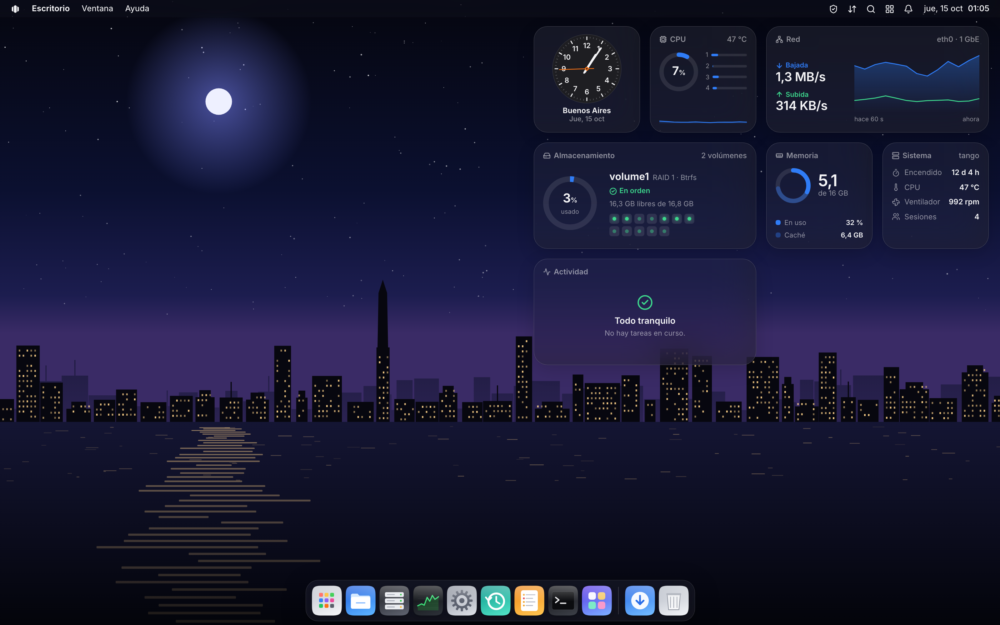

# TangoOS

Open-source (MIT) NAS on Debian 13, with a macOS-style web desktop and real-time administration over WebRTC.
Part of the [go-link](https://go-link.org) ecosystem. Try the demo at **[tangoos.go-link.org/demo](https://tangoos.go-link.org/demo)**.



> **Status: v0.1 (pre-release), in testing.** It manages real disks: Btrfs volumes (Basic and RAID 1/5/6/10
> with mdadm), shared folders with snapshots, SMB with Time Machine and Windows "Previous Versions",
> discovery from Windows (WS-Discovery) and macOS (Bonjour), NFS, SFTP, WebDAV, iSCSI, users with two-step
> verification (TOTP) and app passwords, UPS over NUT, an app center (Docker), transfers over WebRTC and
> remote access with TangoConnect. On the [roadmap](docs/09-roadmap.md), M0–M3.5 are done, M4 (v1.0) is mostly done,
> and TangoConnect from M5 is done. What is missing is in [docs/09 → Next](docs/09-roadmap.md#next-post-v10).
> The interface is in Spanish for now; English is on the roadmap.

## Install

**From the ISO** (recommended: a dedicated machine). Download `tangoos-<version>-amd64.iso` from
[Releases](https://github.com/lordbasex/go-link-tangoos/releases), write it to a USB drive and boot from it. The installer is
graphical; it can also be driven from another computer on the network (`http://<ip>`, with the code shown on screen), and it has a
text mode in the boot menu. It installs in under a minute and leaves the system on Btrfs, with rollback of
updates.

**On a Debian 13 you already have** (amd64, with systemd, ports 80 and 443 free):

```bash
curl -fsSL https://tangoos.go-link.org/install.sh | sh
```

It adds TangoOS's signed APT repository and installs the `tangoos` package; updates arrive from the
desktop itself. This route does not have the system rollback that the ISO gives.

Either way, open `https://<nas-ip>/` and create the administrator account.

## Development

```bash
cd web && npm install && npm run dev   # desktop with simulated data at http://localhost:5173/
make check                              # gofmt, go vet, go test
make web deploy-vm                      # bundle → embedded in tangod → .deb → apt install on the test VM
```

Simulated desktop parameters: `?skip` (straight to the desktop), `?scenario=healthy|degraded|busy|empty|migrate`.
On the demo login any password works; `error` fails.

Your lab settings (`VM`, `SSH_KEY`, `PVE`…) go in `local.mk`, which is not versioned. The end-to-end tests and the
full plan are in [`tests/`](tests/README.md) and [docs/14](docs/14-test-plan.md).

## Layout

```
cmd/          tangod (server), tango-agent (privileged operations), tangoctl, tango-installer, connect-web…
internal/     api, rtc, storage, fileworker, appsys, connect, installer, aptrepo…
pkg/          rtcrpc, agentproto (contracts between processes)
web/          npm workspaces: shell, ui, client, widgets, app-*; apps/desktop and apps/connect (portal)
system/       systemd, ISO, app catalog
protocol/     WebRTC protocol contract
docs/         design, ADRs, roadmap
```

## License

MIT, see [LICENSE](LICENSE).
