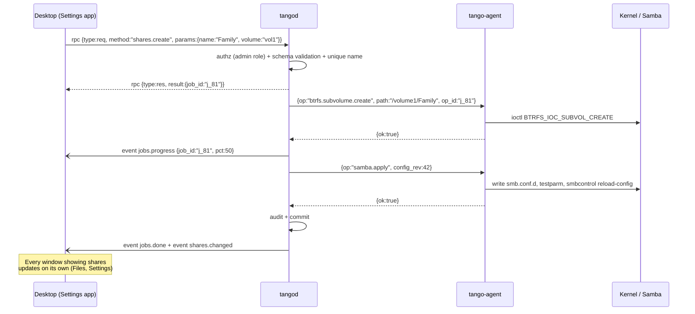

# 02 — Architecture

## Processes on the NAS

```mermaid
flowchart TB
  subgraph Clients
    WEB[Browser<br/>React desktop]
    NAT[Native Win/Linux app<br/>webview + pion]
    SMBC[SMB / Time Machine clients]
  end

  subgraph NAS["NAS — Debian 13"]
    direction TB
    subgraph TANGOD["tangod (tango user, unprivileged)"]
      HTTPS[HTTPS :443<br/>static bundle embed.FS<br/>+ WS /signal]
      STUN[Embedded STUN<br/>pion/turn UDP+TCP 3478]
      RTC[pion/webrtc v4<br/>ICE UDP+TCP mux :8443]
      RPC[RPC router + event bus]
      MOD[Modules: auth · users · shares · files<br/>storage · snapshots · jobs · audit · metrics · apps]
      DB[(State: JSON files<br/>/var/lib/tango)]
    end
    AGENT[tango-agent (root)<br/>Unix socket /run/tango/agent.sock<br/>typed operations]
    OS[Linux: mdadm · btrfs · udev · systemd<br/>Samba · NFS · LIO · smartctl · Avahi]
  end

  WEB -- "1. HTTPS (bundle)<br/>2. WSS (SDP/ICE)" --> HTTPS
  WEB == "3. DTLS/SCTP DataChannels" ==> RTC
  NAT == DataChannels ==> RTC
  NAT -. STUN .-> STUN
  RTC --> RPC --> MOD
  MOD <--> DB
  MOD -- "typed JSON + SO_PEERCRED" --> AGENT --> OS
  SMBC --> OS
```

### `tangod`: the application server

It is a single Go binary, a modular monolith.

- **It runs as the `tango` user**, without privileges. To read and write users' files it
  needs access to the data: this is solved with a per-session **file-worker** process
  that the agent launches as the UID of the authenticated user (see
  [07 §5](07-security.md)). That way the kernel's POSIX/ACL permissions apply as they are, just
  like with SMB.
- It serves the web bundle with `embed.FS`. This differs from go-link-desk, which uses S3:
  here the UI lives on the NAS.
- Signaling is a WebSocket on `/signal` with the **same JSON envelope as signalhub**, so
  the TS client and the `signalclient` library are reused. Since it is local, there are no rooms or
  9-digit codes: the peer is always the NAS itself.
- **Embedded STUN/TURN** (`pion/turn`, UDP 3478). On a LAN it is not needed to connect, because
  the *host* candidates are enough. Planned purposes:
  1. clients behind a VPN or NATed subnets (Docker, VMs, guest Wi-Fi);
  2. the fallback TURN-TCP when UDP is blocked (corporate networks);
  3. being the foundation for TangoConnect.

  **Today** it is **STUN only** (UDP + TCP 3478, no `AuthHandler`: every TURN allocation is rejected).
  When UDP is blocked on the LAN, ICE over TCP on 8443 covers it. TangoConnect does not use it: remote
  peers get STUN + ephemeral TURN from signalhub.
- **ICE on a single port** (`webrtc.NewICEUDPMux` + `NewICETCPMux`, UDP and TCP 8443), which makes the
  firewall easier. mDNS mode `MulticastDNSModeQueryOnly`: it resolves the `*.local` candidates that
  Chrome/Safari use to hide the local IP, and publishes the NAS's real IPs.

### `tango-agent`: the only root process

- It listens on `/run/tango/agent.sock` (mode 0660, group `tango-agent`) and checks
  `SO_PEERCRED`: it only accepts connections from the `tangod` binary and UID.
- Protocol: line-delimited JSON with a version, an `op` from a closed allow-list, its own
  validation independent of `tangod`'s, and an `op_id` for idempotency.
- **100% native Go first** ([ADR 0009](adr/0009-native-go-without-exec.md)): syscalls, ioctl,
  sysfs, netlink and D-Bus. `exec` only as a last resort, with allow-listed binaries
  (`mkfs.btrfs`, `mdadm` in the MVP, `pdbedit`, `apt-get`), arguments built in code and
  never a shell string.
- It writes an **operations journal** (`/var/lib/tango-agent/journal`). If it restarts in the
  middle of an operation, it reports it as `interrupted` and never retries it on its own.

### State and configuration

- The intent (users, shares, snapshot policies, jobs, audit…) is stored as **JSON files** in
  `/var/lib/tango` (`users.json`, `storage.json`, `jobs.json`, `snapshot-schedules.json`, `audit.jsonl`…).
  SQLite (`/var/lib/tango/tango.db`, WAL) was the original plan and is not used.
- **The kernel holds the physical truth.** Volumes and disks are read live from the system (md,
  Btrfs, SMART) and `tangod` raises alerts from what it sees (`internal/monitor`). A full startup
  *reconciliation* of intent vs. `mdadm --detail` / `btrfs filesystem show` / udev is planned; it would
  never correct differences automatically. Jobs left in `running` become `interrupted` at startup.
- Service configuration (Samba sections, `.mount` units, NFS exports) is **generated** by the agent,
  with prior validation (`testparm` for Samba, reverted if it fails). nftables is not managed yet.

## Flow of an operation: create a shared folder



## Domain model

`Disk` → `Array` (md) → `Volume` (Btrfs) → `Share` (subvolume) → `Snapshot`.
Cross-cutting: `User`, `Group`, `ACL`, `Job`, `AuditEvent`, `Session`, `Device` (trusted
client), `App` (container).

## Job lifecycle

`queued → validating → running → succeeded | failed | cancelled | interrupted`

The `interrupted` state is assigned by reconciliation when
`tangod` or the agent died with the job in `running`. The UI shows what got done according to the
agent's journal.

## Why WebRTC and not REST (and its costs)

| Pros | Cost and mitigation |
|---|---|
| A single encrypted bidirectional channel: RPC, events, files, terminal and metrics without polling | Needs its own RPC layer → `pkg/rtcrpc` + codegen (planned; types handwritten today) ([03](03-webrtc-protocol.md)) |
| Remote access traverses NAT the same way as on the LAN (TangoConnect) without exposing an admin HTTPS port to the Internet | HTTP is still needed for the bundle and signaling. It is minimal and has no business logic |
| Native apps speak the same protocol as the web | ``, `<video>` and downloads expect URLs → a Service Worker serves them from the DataChannel ([03 §8](03-webrtc-protocol.md)) |
| Unordered and partially reliable for live metrics | SCTP throughput in the browser is lower than HTTP/TCP → pool of file channels, 1–4 MiB window and **benchmark in M0 as a gate** |
| Same know-how and same libraries as go-link | Debugging tools less mature than curl/devtools → `tangoctl rpc` (CLI with pion) and a channel debug panel |
