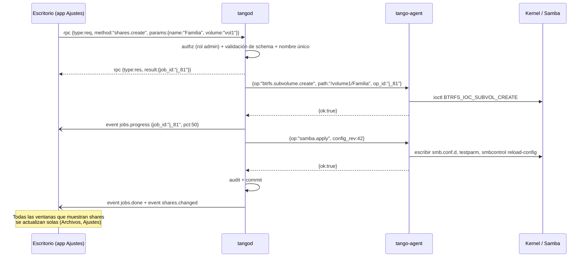

# 02 — Arquitectura

## Procesos en el NAS

```mermaid
flowchart TB
  subgraph Clientes
    WEB[Navegador<br/>escritorio React]
    NAT[App nativa Win/Linux<br/>webview + pion]
    SMBC[Clientes SMB / Time Machine]
  end

  subgraph NAS["NAS — Debian 13"]
    direction TB
    subgraph TANGOD["tangod (usuario tango, sin privilegios)"]
      HTTPS[HTTPS :443<br/>bundle estático embed.FS<br/>+ WS /signal]
      STUN[STUN/TURN embebido<br/>pion/turn UDP 3478]
      RTC[pion/webrtc v4<br/>ICE UDP mux :8443/udp]
      RPC[Router RPC + bus de eventos]
      MOD[Módulos: auth · users · shares · files<br/>storage · snapshots · jobs · audit · metrics · apps]
      DB[(SQLite WAL)]
    end
    AGENT[tango-agent (root)<br/>socket Unix /run/tango/agent.sock<br/>operaciones tipadas]
    OS[Linux: mdadm · btrfs · udev · systemd<br/>Samba · smartctl · Avahi · wsdd2 · nftables]
  end

  WEB -- "1. HTTPS (bundle)<br/>2. WSS (SDP/ICE)" --> HTTPS
  WEB == "3. DTLS/SCTP DataChannels" ==> RTC
  NAT == DataChannels ==> RTC
  NAT -. STUN .-> STUN
  RTC --> RPC --> MOD
  MOD <--> DB
  MOD -- "JSON tipado + SO_PEERCRED" --> AGENT --> OS
  SMBC --> OS
```

### `tangod`: el servidor de aplicación

Es un único binario Go, un monolito modular.

- **Corre como el usuario `tango`**, sin privilegios. Para leer y escribir archivos de los
  usuarios necesita acceso a los datos: se resuelve con un proceso **file-worker** por sesión
  que el agente lanza como el UID del usuario autenticado (ver
  [07 §5](07-seguridad.md)). Así los permisos POSIX/ACL del kernel se aplican tal cual, igual
  que en SMB.
- Sirve el bundle web con `embed.FS`. Esto cambia respecto de go-link-desk, que usa S3:
  acá la UI vive en el NAS.
- La señalización es un WebSocket en `/signal` con el **mismo sobre JSON que signalhub**, así
  el cliente TS y la librería `signalclient` se reutilizan. Al ser local, no hay salas ni códigos
  de 9 dígitos: el par siempre es el propio NAS.
- **STUN/TURN embebido** (`pion/turn`, UDP 3478). En LAN no hace falta para conectar, porque
  alcanzan los candidatos *host*. Sirve para tres cosas:
  1. clientes detrás de VPN o subredes con NAT (Docker, VMs, Wi-Fi de invitados);
  2. el TURN-TCP de respaldo cuando el UDP está bloqueado (redes corporativas);
  3. ser la base de TangoConnect.
- **ICE en un único puerto UDP** (`webrtc.NewICEUDPMux`), que facilita el firewall. Además
  `MulticastDNSModeQueryAndGather`, porque Chrome/Safari ocultan la IP local tras candidatos
  `*.local`.

### `tango-agent`: el único proceso root

- Escucha en `/run/tango/agent.sock` (modo 0660, grupo `tango-agent`) y verifica
  `SO_PEERCRED`: solo acepta conexiones del binario y UID de `tangod`.
- Protocolo: JSON por línea con versión, `op` de una allow-list cerrada, validación propia
  independiente de la de `tangod` y un `op_id` para idempotencia.
- **100% Go nativo primero** ([ADR 0009](adr/0009-go-nativo-sin-exec.md)): syscalls, ioctl,
  sysfs, netlink y D-Bus. `exec` solo como último recurso, con binarios de una allow-list
  (`mkfs.btrfs`, `mdadm` en el MVP, `pdbedit`, `apt-get`), argumentos armados por código y
  nunca un string de shell.
- Escribe un **journal de operaciones** (`/var/lib/tango/agent-journal/`). Si se reinicia a
  mitad de una operación, la reporta como `interrupted`, nunca la reintenta sola.

### Estado y configuración

- **SQLite** (`/var/lib/tango/tango.db`, WAL) guarda la intención: usuarios, grupos, shares,
  políticas de snapshot, preferencias del escritorio por usuario, jobs y auditoría.
- **La verdad física la tiene el kernel.** Al arrancar se *reconcilia*: se compara la intención
  con lo que reportan `mdadm --detail`, `btrfs filesystem show` y udev. Las diferencias se muestran
  como alertas; nunca se corrigen solas.
- La configuración de servicios (`smb.conf`, unidades systemd, nftables) se **genera desde
  plantillas** a partir de SQLite y la aplica el agente, con validación previa
  (`testparm`) y backup del archivo anterior.

## Flujo de una operación: crear carpeta compartida



## Modelo de dominio

`Disk` → `Array` (md) → `Volume` (Btrfs) → `Share` (subvolumen) → `Snapshot`.
Transversales: `User`, `Group`, `ACL`, `Job`, `AuditEvent`, `Session`, `Device` (cliente
de confianza), `App` (contenedor).

## Ciclo de vida de un job

`queued → validating → running → succeeded | failed | cancelled | interrupted`

El estado `interrupted` lo asigna la reconciliación cuando
`tangod` o el agente murieron con el job en `running`. La UI muestra qué quedó hecho según el
journal del agente.

## Por qué WebRTC y no REST (y sus costos)

| A favor | Costo y mitigación |
|---|---|
| Un único canal bidireccional cifrado: RPC, eventos, archivos, terminal y métricas sin sondeos | Requiere su propia capa de RPC → `pkg/rtcrpc` + codegen ([03](03-protocolo-webrtc.md)) |
| El acceso remoto atraviesa NAT igual que en LAN (TangoConnect) sin exponer un puerto HTTPS de admin a Internet | Todavía hace falta HTTP para el bundle y la señalización. Es mínimo y no tiene lógica de negocio |
| Las apps nativas hablan el mismo protocolo que la web | ``, `<video>` y las descargas esperan URLs → Service Worker que las sirve desde el DataChannel ([03 §8](03-protocolo-webrtc.md)) |
| Unordered y parcialmente confiable para métricas en vivo | El throughput de SCTP en el navegador es menor que HTTP/TCP → pool de canales de archivos, ventana de 1–4 MiB y **benchmark en M0 como gate** |
| Mismo know-how y mismas librerías que go-link | Herramientas de debug menos maduras que curl/devtools → `tangoctl rpc` (CLI con pion) y panel de debug de canales |
